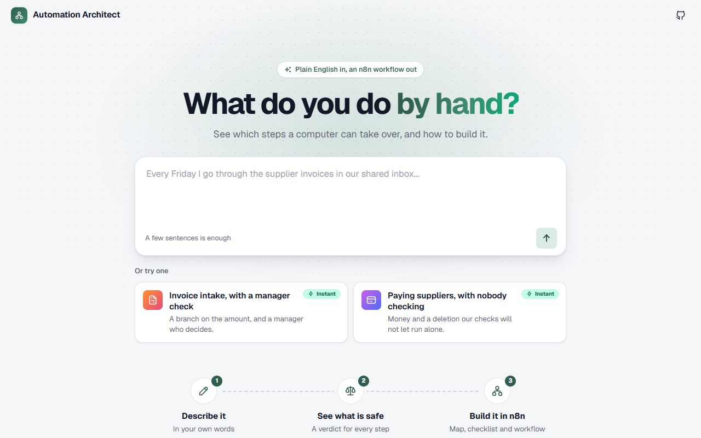
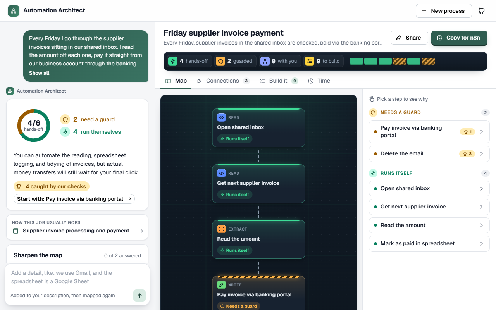
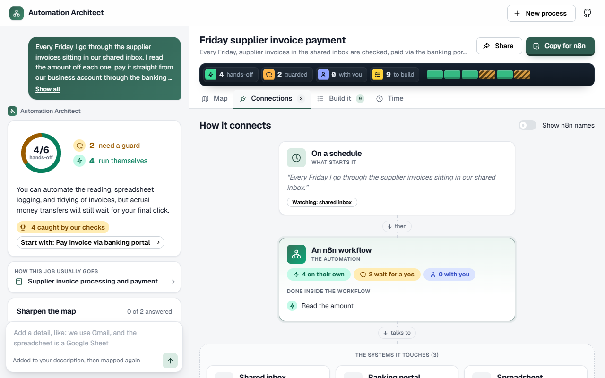
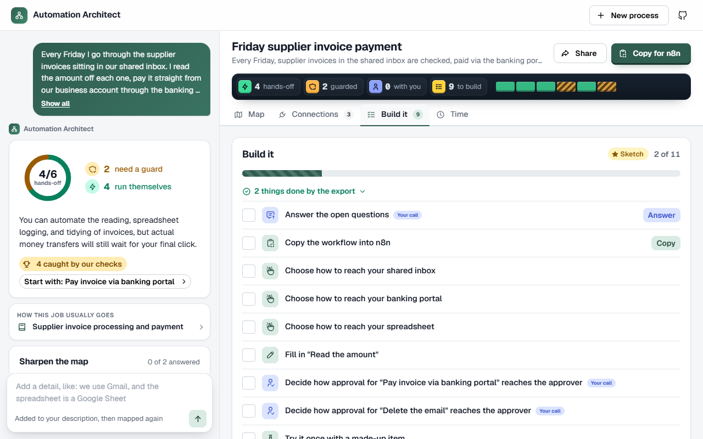
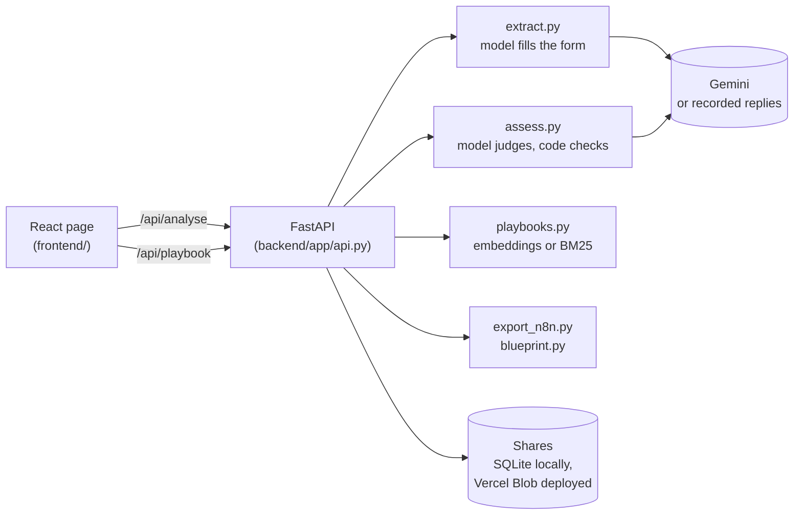

# Automation Architect

**Describe a job you do by hand and see which steps are safe to automate, before anyone builds it.**

<p align="center">Python, FastAPI, React, Gemini · prototype · MIT · <a href="#run-it-locally">Run it locally</a></p>

<p align="center">
  <a href="LICENSE"></a>
  <a href="https://ai-auto-architect.vercel.app"></a>
</p>

<p align="center">
  
  
  
  
</p>

## Why it exists

Ask a chatbot to design an automation and it will happily design one that pays a supplier and then deletes the evidence. Here the model understands the process, but the code makes the final call. A step that moves money, cannot be undone or carries legal weight can never come back marked safe to run unattended, and a scored eval suite checks that this holds.

## What it does

- **Maps the process.** You describe the job in plain English; the model fills in a structured form, and the code validates the graph and asks again with the faults if it is broken.
- **Judges each step, then checks the judgement.** The code adds risks the model missed, downgrades verdicts, adds guards and records every change it made. See `NEVER_FULLY_AUTOMATIC` and `mandatory_risks` in [`assessment.py`](backend/app/schemas/assessment.py), and `_normalise` in [`assess.py`](backend/app/assess.py).
- **Finds the article for the job.** Twelve written articles about common processes; the closest one is shown beside yours, and nothing is shown when none is close enough.
- **Works out the time saved from your numbers.** How often and how long per step come from you. It will not guess them.
- **Hands over to n8n.** A first-draft workflow on your clipboard, with real IF, Switch and Wait nodes. A system you named becomes its real n8n node; what only you know is left empty and each node's note says so. A connections map and a build checklist come from the same functions as the export.
- **Shares a link and keeps your draft.** Share links use an unguessable id and expire after 30 days. Your draft stays in your own browser for 7 days.

Here is the code overruling the model on a recorded payment process with no approval step (trimmed):

```
$ python scripts/analyse.py --replay payment-no-approval

[ guard ]  delete_email
            risks: irreversible
            ! we changed this: nothing flagged -> irreversible
            ! we changed this: fully_automatable -> automatable_with_control
            ! we changed this: no guard -> human_approval

Runs on its own: 4   Needs a guard: 2   Stays with you: 0   Unclear: 0
```

## How it fits together



The page makes two separate requests. The slow one makes two model calls (about 10 to 20 seconds) to map and judge the process. The fast one compares a single embedding with the twelve articles (about 1 second), so the article still arrives when the model is slow or down. Without an API key or network, retrieval falls back to BM25; there is no vector database, just a 160KB file and a loop.

## Run it locally

1. **Prerequisites.** Python 3.11 or newer, and Node.js 18 or newer for the page (Vite 6 needs it). A free [Google AI Studio](https://aistudio.google.com) key is optional: the two recorded examples need no key.
2. **Install the backend.**
   ```bash
   cd backend
   python -m venv .venv
   .venv/Scripts/python -m pip install -r requirements.txt
   ```
3. **Try it from the command line**, with no key:
   ```bash
   .venv/Scripts/python scripts/analyse.py --replay payment-no-approval
   ```
   With a key, on your own words: set `GEMINI_API_KEY` in your environment (there is no `.env` file), then run `.venv/Scripts/python scripts/analyse.py "describe something repetitive you do"`.
4. **Run the web version** in two terminals:
   ```bash
   cd backend
   .venv/Scripts/python -m uvicorn app.api:app --port 8000
   ```
   ```bash
   cd frontend
   npm install
   npm run dev
   ```
5. **Open** http://localhost:5173 and pick one of the two examples marked Instant.

**Tests.** From `backend/`. Only `live` calls the model:

```bash
.venv/Scripts/python -m pytest                   # 382 tests
.venv/Scripts/python scripts/eval.py             # the safety rules
.venv/Scripts/python scripts/eval.py replay      # the pipeline, recorded answers
.venv/Scripts/python scripts/eval.py playbooks   # retrieval
.venv/Scripts/python scripts/eval.py live        # the pipeline, real model (needs a key)
```

The evals check properties, not wording: "the step that deletes something did not come back safe". Nearly half the cases are harmless steps that must stay quiet. The runner exits non-zero on a regression.

### Deploying

One Vercel project serves the API (through `index.py`) and the built page together: `vercel` to link, then `vercel --prod`. Sharing needs Vercel Blob storage, which sets `BLOB_READ_WRITE_TOKEN`; without it, everything else still works. `GEMINI_API_KEY` is optional: without it the recorded examples work and typed descriptions get a plain message. Every model call, repair and retry in one request shares a 100 second deadline, inside the 120 seconds the platform allows.

## Where things are

| Folder | What lives there |
| --- | --- |
| `backend/app` | The FastAPI app, the pipeline (extract, assess), the safety rules, retrieval, the n8n export and sharing |
| `backend/playbooks` | The twelve articles and their embedding vectors |
| `backend/recordings` | Saved model replies for the two examples, so they run with no key |
| `backend/evals` | Eval cases, checks, baselines and the model bake-off results |
| `backend/scripts` | Command-line tools: analyse, eval, bakeoff, embed the playbooks |
| `backend/tests` | The pytest suite |
| `frontend/src` | The React page (Vite, Mantine, React Flow) |
| `docs` | Screenshots |

## Status and limits

A working prototype with a public demo. The pipeline, the page, retrieval, answerable questions, time figures, sharing, the n8n export and the eval suite all work.

- **The model is Gemini 3.5 Flash-Lite.** On five live cases (24 September 2026) it passed 24 of 26 checks at 14.8 seconds per analysis, and was the only model tried that finished every case. Results are in `backend/evals/bakeoff`.
- **Retrieval was scored** on 22 labelled queries, 8 of which must return nothing: embeddings got 21 right, BM25 got 18. Both thresholds favour showing nothing over showing an irrelevant article.
- **The n8n export is a first draft.** You still choose how to reach each system and fill in what only you know; the Build it checklist lists what is left.
- **Known eval gaps stay in the suite** and are reported rather than deleted.
- **Your data:** drafts stay in your browser for 7 days, share links are stored for 30 days, nothing else you type is kept, and there are no accounts. If a model key is set on a deployment, anyone using the page spends that quota, within a daily budget (`backend/app/limits.py`).

## How this was built

Written with AI assistance (Anthropic's Claude), directed and tested by Lattrell Caesar.

## More from latczar

| Project | What it is |
| --- | --- |
| [agentic-qa-tcm](https://github.com/latczar/agentic-qa-tcm) | AI-written Playwright tests, checked by real gates and human review. |
| [agentic-qa-sd](https://github.com/latczar/agentic-qa-sd) | Local AI service desk with a human approval gate. |
| [doctor-outreach-demo](https://github.com/latczar/doctor-outreach-demo) | Doctor outreach pipeline with AI drafts and human approval. |
| [dturbanada-booking](https://github.com/latczar/dturbanada-booking) | Coach seat booking, QR tickets and staff tools for a Philippine operator. |
| [mintern](https://github.com/latczar/mintern) | AI marketing strategist that drafts posts and waits for your yes. |
| [remote-jobs-mvp](https://github.com/latczar/remote-jobs-mvp) | Remote job board showing which countries can apply, with proof. |

## Licence

MIT. See [LICENSE](LICENSE).
